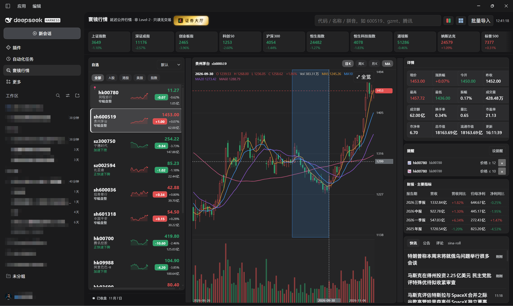
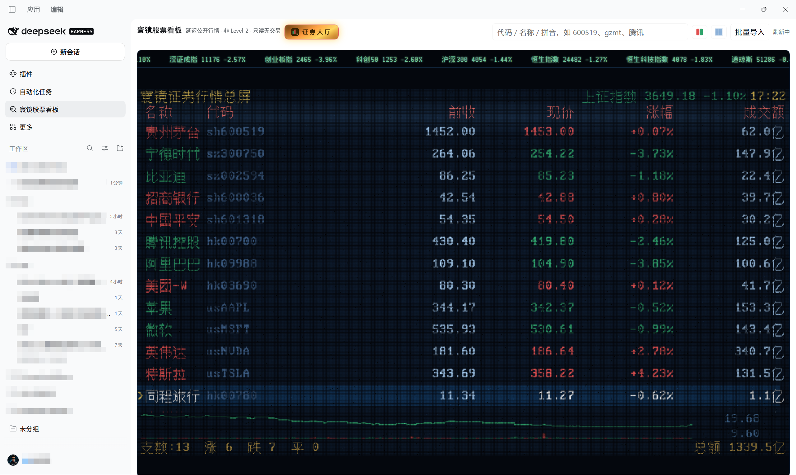
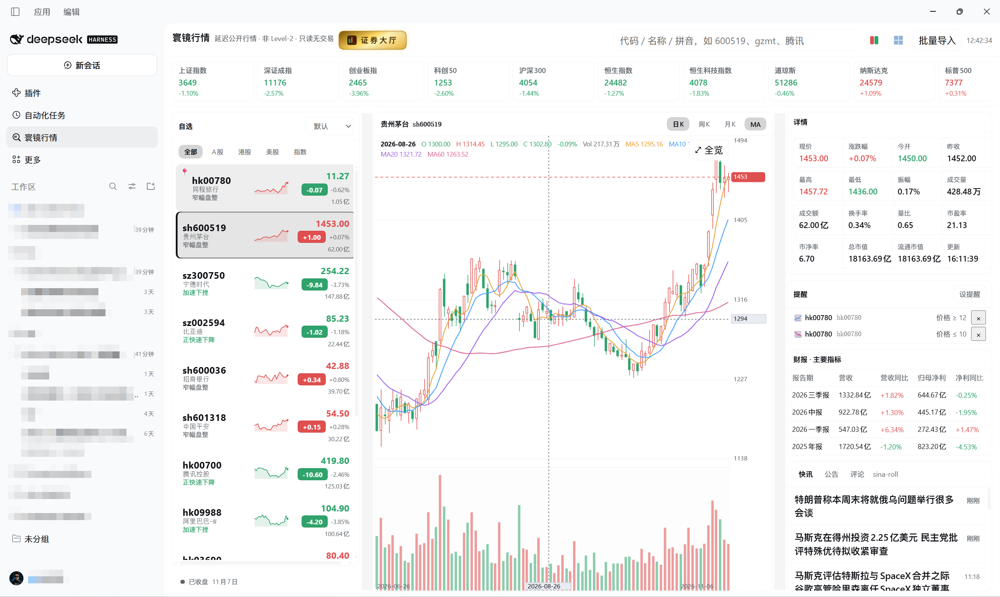

# 寰镜股票看板 MarketLens（@suifei/dsh-market-lens）

> **一句话定位**：纯粹的摸鱼看股票插件——行情分析和交易请用专业软件，专业的人做专业的事；它就是给散户方便看看自己股票情况的，**极致简单**。

A股 / 港股 / 美股的**只读**看盘·盯盘股票看板 DSH Web 插件——Web 面板形态覆盖 PC 与移动端的延迟股市行情，摸鱼友好，**不接任何交易端能力**。

- 数据性质：公开免费接口的**延迟行情**，非 Level-2，UI 常驻标注。
- 市场：A 股（沪/深/北）、港股、美股；指数、个股（板块视图在后续版本）。
- 不做：下单、撤单、持仓盈亏、量化执行、任何写操作（连配置写回都没有）。

> 安装走 **`dsh plugin`**（见下文），包本体发布在 npm 上：当前 **0.34.x**。≤0.27.0 的宿主模块依赖在精简 profile 下解析不到（loader 静默不挂载）；0.27.1 起 schemastery/dsh-tools 为真实依赖；0.29.0 起大厅为 WebGL2 灯墙管线（平面 LED、圆灯珠、光散射、无缝滚动）。

## 安装

用 DSH 自带的 `dsh plugin` 一条命令装进对应 profile——它会把包加进依赖、**同时把 bundle 写进 `dsh.profile.bundles`**，不需要你手改 patch 文件。

### 桌面版（DSH Desktop）

```bash
dsh plugin --profile desktop add @suifei/dsh-market-lens
```

装完**重启 DSH Desktop**：左侧栏出现「寰镜股票看板」，顶部工具栏点「证券大厅」进入 800×450 灯墙大屏。

### Web 版（dsh web）

```bash
dsh plugin --profile web add @suifei/dsh-market-lens
dsh web                 # 启动 Web 版；换端口用 dsh web --port 8080
```

浏览器打开后同样从左侧栏进入；改完/升级后刷新页面即生效。

### 指定版本 / 源码快照 / 卸载

```bash
dsh plugin --profile desktop add @suifei/dsh-market-lens@0.34.3              # 钉版本
dsh plugin --profile desktop add github:suifei/dsh-market-lens#<40 位 commit>  # 从仓库快照装
dsh plugin --profile desktop remove @suifei/dsh-market-lens                  # 卸载
```

> 也可以不用命令行：在 DSH 的「插件管理」界面按包名安装，效果等价。

### 手动挂载（不使用 `dsh plugin` 时）

在 profile 的 `cordis.patch.yml` 里挂载宿主半（客户端半由包内 `dsh.client` 声明自动发现）：

```yaml
- insert:
    - id: market-lens
      name: '@suifei/dsh-market-lens'
```

可选 `config`（`diagLevel`、`pollIntervalMs`、`scrollVpx` 等）见下文配置节。

## 截图

| 三列首页 · 暗色 | 证券大厅（灯阵总屏 · 紧凑档） | 三列首页 · 亮色 |
|---|---|---|
|  |  |  |

首页 = 指数条 / 自选列表（代码主视觉 + 微型趋势线 + 涨跌胶囊 + 市场状态条）/ K 线（MA、量副图、框选放大）/ 详情卡 + 提醒 + 财报 + 资讯四段右栏。大厅 = UCDOS 血统点阵字库驱动的交易所总屏，**固定 800×450 灯格矩阵**（灯珠 3×3 像素、灯距 3.5 像素、0.5 像素灯缝，离屏原生渲染整墙 **2800×1575** 像素），成品画面**等比缩放居中显示**到容器（含黑边，永不裁切），任何窗口看到的是同一面屏

## 架构

```
浏览器（DSH Web GUI）                      Node（DSH Host）
┌─────────────────────────┐   同源 HTTP   ┌──────────────────────────┐
│ client.js  React 面板     │ ───────────→ │ index.js                  │
│ · sidebar.panellist 图标  │  /market-lens│  · /market-lens/* routes   │
│ · main keyed 主面板        │   /*        │  · market_search/quotes/   │
│ · Canvas 自绘 K 线（零 CDN）│             │    kline 三个只读工具        │
│ · localStorage 自选/偏好   │             │ lib/service.js             │
└─────────────────────────┘             │  归一化 · TTL 缓存 · 在途去重 │
        UI 永不直连外部行情接口             │  多源降级（按市场分链）        │
                                        │ sources/{eastmoney,        │
                                        │  tencent,yahoo}.js         │
                                        └──────────────────────────┘
```

**行情抓取只发生在宿主侧。** UI 与模型工具共用同一个 `createMarketService`，一个操作、两个调用方。

## 符号规范

内部规范格式（与腾讯公开接口词表一致）：

| 市场 | 规范 | 接受输入 |
|---|---|---|
| 沪/深/北 | `sh600519` `sz000001` `bj830799` | `600519`、`SH600519`、`sh.600519`（裸 6 位按代码段推断：`5/6/9`→sh，`0/3/1`→sz，`4/8`→bj） |
| 港股 | `hk00700`（5 位）、指数别名 `hkHSI` `hkHSTECH` | `700`、`00700`、`HK00700` |
| 美股 | `usAAPL`、指数别名 `usDJI` `usIXIC` `usINX` | `AAPL`、`us.aapl`、`US.AAPL` |

搜索支持代码、中文名、拼音全拼与**拼音首字母**（`gzmt` → 贵州茅台）：拼音匹配委托给上游 suggest 接口（smartbox / 东方财富），宿主侧只做归一化、合并与去重。

## 多源降级

| 市场 | 主源 | 备源 |
|---|---|---|
| A 股（含北交所）/ 指数 | 东方财富 | 腾讯 |
| 港股 | 东方财富 | 腾讯 |
| 美股 / 美指数 | Yahoo chart | 腾讯（美股 K 线自动解析 `.OQ/.N` 后缀码） |

- 东方财富 TLS 在部分网络被重置：适配器带 **https 失败→http 重试**（仅公开只读 GET）。
- 单源失败自动切换；全链失败时 quotes 返回 `failed[]`（UI 显示「数据暂不可用」），有缓存旧值时以 `stale: true` 供出延迟值而非假数据。

## 面板接口（同源，宿主实现）

| Route | 参数 | 返回 |
|---|---|---|
| `GET /market-lens/meta` | — | `{ pollIntervalMs, defaultWatchlist, indexBar, limits, disclaimer }` |
| `GET /market-lens/quotes` | `symbols`（逗号分隔，≤200） | `{ quotes: QuoteRow[], failed: [{symbol, reason}] }` |
| `GET /market-lens/kline` | `symbol, period=day|week|month, count=20–320` | `{ symbol, period, adjust, bars: Bar[], source }` |
| `GET /market-lens/search` | `q`（1–50）, `limit≤30` | `{ items: [{symbol, name, market, kind}] }` |
| `GET /market-lens/news` | `q?`（关键词，可空）, `limit≤30` | `{ items: [{title, url, time, source}], source }` |
| `GET /market-lens/posts` | `symbol`（必填）, `name?`（新闻关键词） | `{ symbol, notice[], posts[{title,url,time,comments,reads}], news[], source }` — 公告(A股)/股吧评论(A·港)/个股新闻三源并行，单源失败置空，全空 502 |
| `GET /market-lens/updates` | `symbols`（逗号列表） | `{ items: [{symbol, notice[], latest, count, unsupported?}] }` — 自选行的**未读公告气泡**数据源（仅公告源，轻量批查） |
| `GET /market-lens/financials` | `symbol` | A 股：`{ rows: [{report, revenue, revenueYoY, netProfit, netProfitYoY, eps, bps}] }`；港/美：`{ unsupported: true }` |
| `GET /market-lens/alerts` | `since`（事件游标） | `{ alerts, events, cursor }`；`POST` 新建规则或 `{action:'dismiss'}` 清未读；`DELETE ?id=` 删规则 |

`QuoteRow = { symbol, name, price, prevClose, open, high, low, change, changePct, volume(股), amount(元), turnoverRate, pe, volRatio, amplitude, pb, marketCap, floatMarketCap, currency?, updatedAt, source, stale? }`。字段可得性因市场与源而异：**缺失为 `null`，UI 显示 `—`，绝不补 0**。K 线前复权固定在宿主侧，UI 与工具都不暴露复权参数。

路由带同源护栏：`Sec-Fetch-Site: cross-site` 或 Origin/Referer 与 Host 不一致一律 403；全部 `cache-control: no-store`。

## 模型工具（只读）

| 工具 | 参数 | 说明 |
|---|---|---|
| `market_search` | `query(1–50)`, `limit?≤30` | 代码/名称/拼音检索 |
| `market_quotes` | `symbols: string[]`（≤200） | 批量报价，含 `source` 与 `stale` 标注 |
| `market_kline` | `symbol`, `period: day|week|month`, `count: 20–320` | 前复权 K 线 |

工具描述内写明「只读行情、不涉及交易」；上限同时写在参数描述与宿主校验（越界报 `BAD_INPUT`）。没有 `market_order` 之类的写工具。

## 可靠性实现点

- 轮询：`setTimeout` 链式调度，上一次完成后才排下一次；`document.hidden` 暂停，回前台立即刷新（面板卸载即整链拆除）。
- 收回：样式、监听、AbortController、定时器全部挂在 `ctx.effect` / 组件 cleanup。
- 指数条与自选行按 key 原地更新文本，不重建列表 DOM，滚动位置与手动顺序不被轮询重置。
- K 线：Canvas 自绘；PC 滚轮缩放 + 拖拽平移 + hover tooltip；移动端双指缩放、单指平移、长按出 tooltip（不依赖 hover）。
- 搜索带序号防竞态，慢的旧响应不覆盖新输入。

## 配置（`cordis.patch.yml` 行内 `config`）

`pollIntervalMs 5000 · quoteTtlMs 5000 · klineTtlMs 60000 · searchTtlMs 300000 · newsTtlMs 60000 · finTtlMs 21600000 · upstreamTimeoutMs 6000 · maxQuoteSymbols ≤200 · maxKlineCount ≤320 · routePath /market-lens · diagLevel errors · scrollVpx 28（大厅行情带滚动速度，单位墙像素/秒；0=冻结，上限 160）`

## 诊断日志（自监控闭环，**全局开关**）

**`diagLevel` 是日志总开关**：`off` 完全静音（不落盘、客户端连 POST 都不发）；`errors`（**发布默认**）只保留崩溃/失败行（`panel.crash`、`*.fail`、`route.status`、`route.reject`），日常事件零写盘；`full` 记录一切——开发调试期用。仓库自带的 `cordis.patch.yml` 行内写了 `config: { diagLevel: full }`（开发机现状），**发布前删掉或改回 `errors`** 即可回到静音默认；普通使用者不配置天然是 `errors`。

面板把关键事件（挂载、每类请求成败、渲染崩溃）批量 POST 到 `/market-lens/diag`，宿主连同护栏拒绝与非常规状态码一起写入 JSONL 日志（客户端与服务端各有一道同级过滤，`full` 之外不产生流水）：

- 位置：`~/.dsh/market-lens/marketlens-diag-<YYYY-MM-DD>.jsonl`（`diagLogDir` / `diagLogMaxBytes` 可在插件配置改，按天分文件、超限轮转为 `.1`）。
- 回读：`GET /market-lens/diag?tail=50` 返回 `{file, rows}`；面板红条本身也带原因。

## 自选行（对齐 Apple「股市」层级）

每行 = **代码大字主视觉 + 灰色名称** + **22 日微型趋势线**（SVG，面积渐变 + 端点强调，红涨绿跌跟随当前配色系；悬停显示 5 日累计涨幅）+ 右侧现价粗体（方向色）与**红/绿实底白字涨跌胶囊**（副行小字涨幅%与成交额）。选中行以 inset 圆环描边浮出；行距靠留白分层，不铺卡框，**一句话建议**（强势拉升/稳步走高/窄幅盘整/快速下降/加速下挫）作为名称下第三行方向着色小字。列表底部常驻**市场状态条**：集合竞价 / 交易中 / 午间休市 / 已收盘 + 日期（按北京时间 A 股时段，30s 自刷新）。趋势线宿主侧走 K 线缓存（5 分钟窗口），过滤、排序、置顶切换均不重复请求。筛选与周期按钮为**灰底分段胶囊**（选中提亮加粗、无描边）；资讯标题粗体，时间用**相对显示**（当日钟点，更早 "N周前"）。

## K 线交互与配色

拖拽框选放大 · 滚轮以光标为锚缩放 · **右键拖动平移时间轴** · 双击回全览；**点击 K 线**在图下方展开当日详情条（开高低收、涨跌、涨幅、振幅、量），再点一次取消。悬停十字光标带主题化价签/日期签与左上角 OHLC/MA 图例；最新价虚线 + 轴上价签常驻。

配色五系可切换（工具栏「配色」）：红涨绿跌（**空心阳线**，默认）、绿涨红跌、蓝涨橙跌、紫涨金跌、青涨玫跌；选择持久化在 `ml.prefs.v1`，全部颜色走 CSS 变量并跟随宿主明暗主题。

## 横向滚动规范

界面默认不出现横向滚动条。确需横向内容的区域（指数条、财报横表）统一用 `HScroll`：滚动条**悬停/聚焦才现身**（细圆角、跟随主题），两侧**渐隐边缘**提示还有内容（可滚状态实时更新），触屏 `pan-x` 原生拖动、`overscroll-behavior` 防串滚，`tabIndex` 支持键盘横滚。纵向滚动条全局统一为透明轨道 + 悬停显色的细圆角样式。

## 看盘模式（0.7）

- **三列分割条**：列表/K线/详情两缝可拖（260–460 / 280–560 px 限位），宽度写入 `ml.prefs.v1.cols`，窄模式隐藏分割条。
- **证券大厅**（标题右侧的金色按钮，点阵图标 + 悬停像素提示条）：**真·灯矩阵屏**——**固定 800×450 灯格矩阵**（灯珠 3×3 像素、灯距 3.5px、灯缝 0.5px，离屏墙 2800×1575 像素，与容器分辨率解耦），整墙按 contain 等比缩放合成到画布（平滑降采样，拍真屏的观感）；文字不走字体渲染，用 **UCDOS 血统的点阵字库**（HZK16 汉字 16×16 + ASC16 半角 8×16，8178 字，388KB，`/market-lens/font` 同源供给的 lamp.bin）一个点模烘焙一颗灯，矩阵恒为四列总屏（名称/代码 + 前收/现价/涨幅/成交额等距铺满，指数条钉右上、K 线带与汇总页脚钉底，自选单屏尽收），行距等化顶满 450 格；工具栏可切**两档点阵**：标准 16×16 / 紧凑 8×8（2×2 OR 折叠）
- **个股资讯区**：原"快讯"卡升级为三 Tab——**快讯**（全市场）/**公告**（东财公告，A 股）/**评论**（股吧热帖，A·港股，带回复数），公告与评论跟随当前选中股票，走 `/market-lens/posts` 聚合路由（三源并行、单源失败置空）。
- **当日详情条增强**：点选 K 线后除 OHLC/额量外附**信号标签**——20 根内新高/新低、放量倍数（×n），全部由已在手的 K 线数据本地计算，不加请求。

## 价格提醒（宿主后台评估）

规则存于 `~/.dsh/market-lens/alerts.json`，**评估循环跑在宿主**——面板不开、网页不在前台，提醒照常触发。七类规则：`priceUp/priceDown`（价格≥/≤）、`pctUp/pctDown`（当日涨/跌幅≥）、`maUp/maDown`（上穿/下破 MA5/10/20/60，需拉日线，隔轮评估）、`volSpike`（量比≥，东财源提供）。触发产生事件流（保留 200 条），每条规则带独立**静默期**（默认 30 分钟）防轰炸。

展示：桌面壳底部 `shell.bottom` 状态条——🔔 摇铃动效 + 多行**向上跑马灯**（3 秒一行，涨跌红绿着色），**悬停即停**，点击行跳到行情面板并把该提醒对应的股票选为当前标的，「清除」把当前所有事件标为已读。
- 排障顺序：先看有没有 `route.reject`（护栏误伤）→ `route.status`（路径/参数错）→ `panel.*.fail`（上游源问题）→ `panel.crash`（渲染问题）。

## 数据内容

- **预制自选**：首次打开即有 12 只中外明星股（茅台/宁德/比亚迪/招行/平安/腾讯/阿里/美团/苹果/微软/英伟达/特斯拉）+ 顶部 10 指数条。
- **财经快讯**：新浪财经滚动（支持按标的名称过滤）为主，东财 7×24 备源；60s TTL。
- **财报**：东财 F10 主要财务指标（营收/净利/EPS/BPS + 同比），A 股已支持，港/美股显式标注暂不支持。

## 开发

```bash
node --test                    # 离线单测（fetch 全桩）
node scripts/live-probe.mjs    # 真网络冒烟（不在测试里跑，避免 CI 依赖外网）
```

大厅版式改动必须先跑**离线自检链**（布局唯一事实源是 `client.js` 的纯函数 `ledPlan`，浏览器绘制器与本链共用）：

```bash
node scripts/led-shot.mjs      # 固定 800×450 格矩阵（墙 2800×1575px）mock 行情 → shots/plan-800x450.json（灯带三帧：静置/半行裁切/第二周期）
python scripts/led-shot.py     # lamp.bin 真点阵重绘 + 带窗 clip 对齐浏览器 → shots/shot-*.png + 撞字审计
```

审计 0 碰撞才允许提交；`shots/` 为临时产物不入库。

## 发布（三渠道，一条命令）

```bash
node scripts/release.mjs <x.y.z> --msg "..." --token <npm granular token> [--host-port N]
```

八道门（版本三同步 → 语法 → 测试 → 灯墙自检 → 提交+tag+push → npm publish → registry/host 核验 → 渠道清单），规程与事故先例见 **`docs/RELEASE.md`**。三个渠道分工：**npm**＝发行本体；**dsh.so 插件市场**＝提交 `github.com/suifei/dsh-market-lens`（注意不是 `market-lens`）；**awesome-dsh-plugin**＝收录 PR（条目 `data/plugins/suifei__dsh-market-lens.yml`，只动这一个文件）。

## 发布自检（社区市场流程）

1. 仓库 `github.com/suifei/dsh-market-lens`，public；本目录即包根（`package.json` 声明 `dsh.bundle.patch` → `./cordis.patch.yml`）。
2. `dsh-plugin` topic；`meta.title/description` 在 `locale/zh.json`、`locale/en.json`。✓
3. 建仓满 1 天后再提收录 PR。
4. 向 `awesome-dsh-plugin/awesome-dsh-plugin` 的 `data/plugins/` 提交单文件条目 `suifei__dsh-market-lens.yml`（category 以当时 contributing.md 为准），不动自动生成的 README。
5. npm 为必发渠道：`npm view @suifei/dsh-market-lens version` 应等于刚打的 tag；历史版本 `0.0.0-stage` 是 scope 建包副产，已标废弃，无害。
6. 带 UI 包自查：`dsh.bundle.patch` 存在 ✓；`dsh.client.platform: web` ✓；宿主半自持运行时依赖（`dependencies: @deepseek-ai/schemastery、@deepseek-ai/dsh-tools`，版本对齐宿主），`peerDependencies` 仅 cordis（宿主注入）——link/file/npm 三种安装路径均可解析。

## 首版范围与后续

**首版必做**：自选列表（过滤/排序/批量导入，预制 12 只中外明星股）+ 三市场报价 + 日/周/月 K（MA5/10/20/60 可开关、量副图）+ 指数条 + 搜索 + 财经快讯 + A 股财报指标 + 移动端布局模式切换 + 宿主缓存与多源降级 + 三个只读工具。（快讯与财报原在说明书第二版范围，按用户要求提前落地；新闻为全局滚动流 + 标的关键词过滤，非独立新闻聚合面。）

**明确不做**：交易、持仓、选股、AI 投研、L2 盘口。

**后续（按数据源稳定性排序）**：分时图 → 板块/行业视图 → 热力图 → 自定义布局保存（财经快讯与 A 股财报早在 0.2.0 公开版即已落地，此清单漏划）。原则不变：**新数据源先落在宿主侧，UI 只消费归一化结构。**

## 已知边界

- 裸 6 位代码按号段猜测交易所（`92xxxx` 北交所新代码段会被猜成 sh）；带前缀输入永远正确。
- Yahoo 在部分区域返回 403：美股自动落到腾讯，K 线历史长度可能缩短。
- 分时图未进首版；详情页暂以 K 线为主视图。

## 安全

本包只读公开行情、无交易无用户数据出口；npm 扫描器告警的逐条处置与证据见 **`SECURITY.md`**（zod 内存 DoS 已在 0.29.3 修复，其余 eval/URL 等为误报或职责所需）。

## License

MIT · 图标为本仓库原创绘制。
